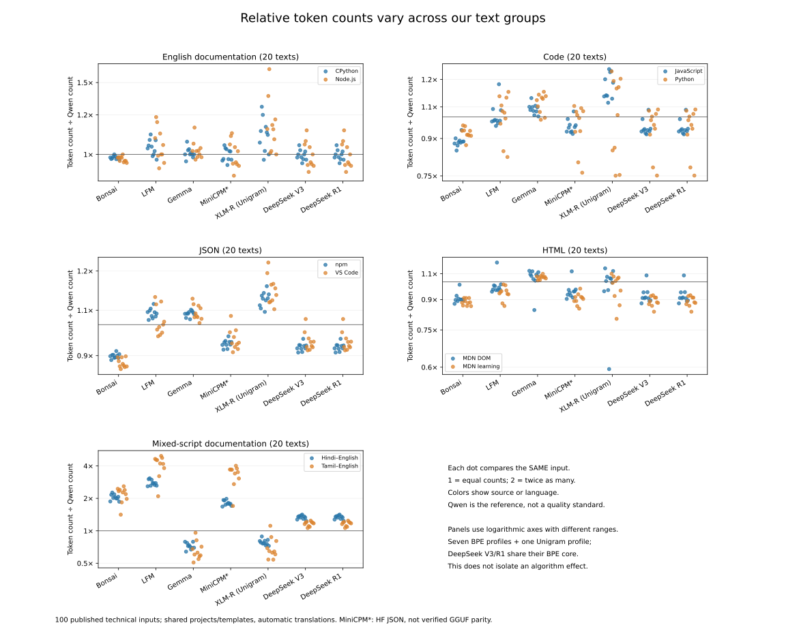

<h1 align="center">Comparative Tokenizer Study</h1>

[Portfolio case study](https://ompatnaik.com/tokenizers/)

**Compare exact token counts across languages and text types with pinned configurations and saved Python/JavaScript checks.**

Python and Node.js. Tokenizer assets download separately; no model weights. Source text and reconstructable token sequences are excluded from Git.

By Om Patnaik · repository created September 2026.

## Install

| Platform / path | Start here |
| --- | --- |
| Read-only inspection | [Latest report](results/2026-10-19-deepseek-extension/REPORT.md) and committed numeric summaries |
| Reproduction | Follow [pinned setup](docs/REPRODUCING_QWEN.md) and the experiment-specific report |

Inspect the saved summaries first; they require no tokenizer download. Reproduction needs pinned local source data, caches, and prior results. Use fresh output directories so frozen experiments remain intact.

```bash
python scripts/test_published_collection.py
```

## Why

You need to budget context, but tokenizer counts vary with language, text type, serialization, and configuration. This study compares same-input counts and reconstruction, separately from estimator claims. Browser startup, memory, latency, and complete-prompt budgets remain unmeasured.

## Results



On these samples, DeepSeek uses 9.5% fewer tokens than Qwen on HTML and 24.4% more on mixed-script documentation. All 1,120 recorded encodings agree between Python and JavaScript.

Rebuild the figure with `python scripts/analyze_deepseek.py --base results/2026-10-19-deepseek-extension --output work/deepseek-figures` using the recorded inputs. [Numeric summaries](results/2026-10-19-deepseek-extension/analysis-01/summary.json) · [Full protocol and rerun sequence](results/2026-10-19-deepseek-extension/REPORT.md).

## Compare like with like

The extension uses 100 published samples and 40 JSON variants. V3 and R1 match on all 140 corpus inputs but differ on added-token probes; identical core counts do not make full chat prompts interchangeable.

## Inspect limits and provenance

Technical-source bias, repeated templates, lengths, and translations limit generalization. Counts omit special tokens unless stated. FLORES+ stays evaluation-only and is not re-hosted; no estimator coefficients were fitted by this study.

## Notes from building it

I separated configuration identity from same-input count comparisons. Independent arithmetic and Python/JavaScript checks exposed distinctions that a single aggregate ratio would hide. I would next measure browser runtime costs and full-prompt budgets before choosing a product strategy.

## Commands

```bash
python scripts/test_published_collection.py       # check collection rules
python scripts/verify_deepseek.py --base results/2026-10-19-deepseek-extension  # audit with pinned local inputs
node scripts/check_deepseek_js.mjs results/reproduce-deepseek/js-01  # new JS measurements; requires local assets
```

## Verify it yourself

```bash
python scripts/test_published_collection.py
```

The collection tests run without training. The latest [verification record](results/2026-10-19-deepseek-extension/verification.json) describes sequence-hash and arithmetic checks; full reproduction also needs inputs deliberately excluded from publication.

## Credits, license and pointers

Builds on Hugging Face Tokenizers/Transformers, the pinned tokenizer publishers, LocalMind reference work, and sources listed in [third-party notices](THIRD_PARTY_NOTICES.md). Study by Om Patnaik. No repository source license file is present; upstream assets retain their terms.

[Full setup, original notes, and project history](README-DETAILS.md).
