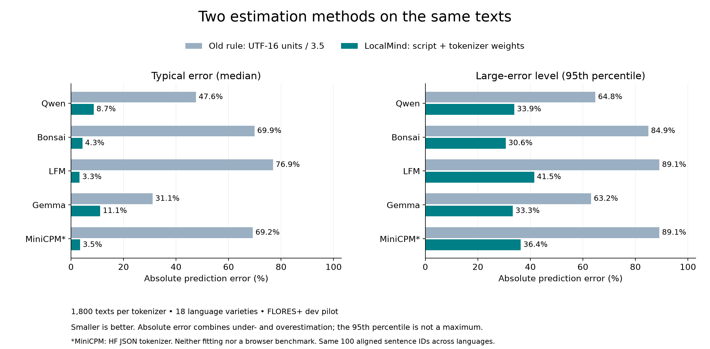
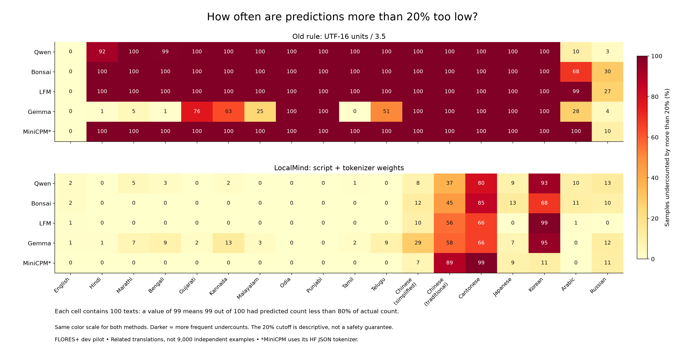
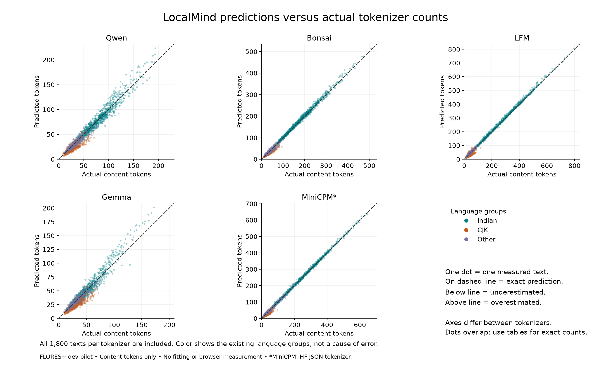

# Reading our research evidence

Updated 2026-10-19. Our main question now concerns tokenizer behavior across
languages and text types, with estimation as one sub-question.
Graphs make measurements easier to understand;
the saved data, methods and checks are the evidence behind them. A graph does
not establish that the estimator is safe for browser use.

## DeepSeek extension — 2026-10-19

[Updated eight-configuration graphs](../results/2026-10-19-deepseek-extension/REPORT.md)
add V3/R1 to the same corpus. The 280 new rows agree across Python/JS; the 840
previous rows remain unchanged. Both DeepSeek profiles match on all corpus inputs,
but targeted reasoning-marker probes differ. They share a BPE core, so matching
dots are not independent evidence from two unrelated tokenizer families.

DeepSeek/Qwen averages 0.997 on English documentation, 0.905 on HTML and 1.244 on
mixed-script documentation. Indentation adds 35.2% on the paired JSON variants.
Both recover all 140 inputs exactly. These are corpus observations, not browser
speed, memory or full-prompt measurements. The earlier figures below remain history.

## Published technical-text experiment — 2026-10-19

Read the [report and three graphs](../results/2026-10-19-published-experiment/REPORT.md).
We measured 100 published samples and 40 paired JSON variants with six profiles.
All 840 Python/JS sequences match; separate arithmetic verifies 1,146 summaries.

- Count-ratio dots compare the **same text** across tokenizers. A factor of 2
  means twice as many tokens; colors separate sources/languages. Different
  panels have different ranges, so read their axis numbers.
- JSON dots compare indented and compact versions of the **same data**. Qwen's
  average factor is 1.609 and Gemma's 1.562. This formatting cost is smaller
  than in our earlier authored fixtures, showing that it is not a fixed constant.
- Reconstruction cells count original inputs that fail exact text recovery.
  XLM-R changes all 100 originals: 99 differ only in whitespace after stripping
  whitespace from both sides; one also loses an initial encoding marker.
  The other five profiles recover all originals and variants exactly.

No unknown IDs appear here; that does not guarantee coverage outside this corpus.
Only the paired JSON experiment isolates layout. Other category contrasts also
reflect source, length and content differences. Mixed-script documentation comes
from automatic translations. One Unigram profile cannot represent its entire
algorithm class. These checks do not measure model answers or browser performance.

## New text-type experiment — 2026-10-18

We now compare our five BPE profiles with one Unigram profile from
[XLM-RoBERTa](https://huggingface.co/FacebookAI/xlm-roberta-base). Its actual method
was checked by loading the pinned tokenizer asset. An encoder tokenizer can be
studied without running its model; we are not comparing chat-model answers.

We authored 12 records, rendered each in five ways, and used three message
conditions: English, Hindi inside English structure, and Tamil inside English
structure. That gives 180 primary inputs and 1,080 measurements across six profiles.
Eight separate probes add 48 diagnostic measurements. This is a deliberately
small, repeatable test, not a random sample of real webpages or programs.

Read the [results and graphs](../results/2026-10-18-text-types/analysis-02/REPORT.md)
and [token examples](../results/2026-10-18-text-types/TOKEN_EXAMPLES.md).

| Finding | Plain-language meaning | Limit |
| --- | --- | --- |
| Pretty/compact English JSON is about 1.93× for Qwen and 1.96× for Gemma | The same data can take nearly twice as many tokens when formatted with spaces and newlines in these templates | Not a constant for every JSON file |
| XLM-R pretty/compact JSON is near 1.00× | This tokenizer largely removes the layout difference during encoding/decoding | It does not reconstruct the formatted input exactly |
| XLM-R/Qwen changes from 0.86× for English prose to 1.56× for compact JSON | Which profile uses fewer tokens depends on the text type | One Unigram profile does not represent every Unigram tokenizer |
| No unknown tokens on the primary inputs; XLM-R unknowns on two probes | Coverage problems can appear outside the ordinary examples | Probe rates are not population rates |

Ratios here are geometric means of 12 matched record ratios. Read each cell as
one count divided by the reference count. Fewer tokens alone does not tell us
whether a tokenizer preserves every character or whether a model answers well.

**Reconstruction** means encoding the text and then decoding the resulting IDs.
An exact mismatch can reflect harmless normalization, changed whitespace or an
unknown character. We report it separately rather than equating every mismatch
with lost meaning. The indentation example shows layout changing without claiming
that this particular small program changes behavior.

The first two new figures show count comparisons and formatting ratios. The third
shows the percentage of inputs whose decoded string changes. All cells have 12
scenarios. Every comparison, including unfavorable outcomes, remains in the
numeric results. The plan and public original fixtures were pushed before counting;
all 1,128 ID-sequence hashes agree across Python and JS, and all 6,552 summary
values passed a separate arithmetic check. The three PNGs were visually inspected.

Original fixtures are shareable and committed. Third-party tokenizer assets stay
in ignored caches; no FLORES+ text was accessed or republished in this experiment.
The earlier sections below remain useful evidence from the multilingual pilot.

## Current comparative results — 2026-10-18

Start with the [five tokenizer fact sheets](../results/2026-10-18-comparative-pilot/inventory-01/REPORT.md).
A tokenizer's vocabulary is its inventory of stored token entries. We counted
those entries and inspected its text-processing configuration. All five files
say BPE, yet their vocabularies and processing pipelines differ. Therefore these
results compare five particular configurations, not five proven historical
families or multiple algorithm classes. A larger vocabulary alone does not
prove better performance.

The [comparison report](../results/2026-10-18-comparative-pilot/run-01/REPORT.md)
contains three new graphs and links to every numeric result:

| Graph | Question | Reading it |
| --- | --- | --- |
| [All tokenizer pairs](../results/2026-10-18-comparative-pilot/run-01/01-pairwise-count-ratios.png) | How do counts compare on identical text? | Row count divided by column count; 2 means twice as many, 0.5 means half |
| [Differences by language](../results/2026-10-18-comparative-pilot/run-01/02-language-ratios-versus-qwen.png) | Does the difference depend on language? | A dot is the middle ratio; its line shows the middle 80% of observed ratios; Qwen is the fixed reference |
| [Translations versus English](../results/2026-10-18-comparative-pilot/run-01/03-aligned-language-ratios.png) | How much does the count change across aligned translations? | Each tokenizer uses its own English count as the reference; translations vary in length and wording |

For the heatmaps we use the **geometric mean**, an average suited to ratios.
For example, ratios of 2 and 8 have geometric mean 4 (the square root of 2 × 8).
This differs from averaging counts first and dividing those averages. The plots
label the method explicitly, and their colors use a logarithmic scale: equal
steps mean equal multiplication factors. The numeric values can be read directly.
The language-distribution plot instead shows the median and observed percentiles.

One concrete result: LFM/Gemma averages about 1.02× on English but 8.26× on Tamil
using geometric means of 100 same-text ratios per language. Their relationship
changes markedly across these language samples. This does not show that one
model answers better, or prove which design choice caused the count difference.

We checked all 565 summaries (5,650 numeric values) with a separate arithmetic
implementation, all 9,000 published counts against the saved measurements, and
all 11 inventory asset files against their recorded hashes. All three PNG figures
were visually reviewed. These are additional analyses of existing measurements,
not newly sampled evidence. The [active protocol](COMPARATIVE_STUDY_V2.md) records
what we chose before this analysis and what was already known.

Reproduction from the existing local caches and pinned pilot Parquet, using a
new destination (scripts refuse to overwrite completed directories):

```sh
.venv/bin/python scripts/inventory_tokenizers.py --output results/reproduction/inventory-01
.venv/bin/python scripts/compare_pilot_counts.py --output results/reproduction/run-01
.venv/bin/python scripts/verify_comparative_pilot.py --run results/reproduction/run-01 --inventory results/reproduction/inventory-01
```

Use `requirements-phase1.lock.txt` for the recorded environment. Source snapshots,
checksums and versions are saved with the results. The public numeric count cube
contains the counts used in all these plots; cached third-party assets, raw text
and the local Parquet remain excluded from GitHub. Recreating those local inputs
requires the earlier pilot workflow and authorized dataset access.

The sections below preserve the earlier estimation-focused figures.

## 1. Do token counts differ across languages and tokenizers?

[Original tokens-per-character heatmap](../results/2026-10-15-phase1-pilot/run-02/tokens-per-character.png)

This compares measured content tokens relative to text length. It shows that
one universal conversion factor is a poor description of these samples. It
cannot tell us which model is more intelligent, or which tokenizer is faster.
The exact measurement definitions and values are in the
[pilot report](../results/2026-10-15-phase1-pilot/run-02/REPORT.md).

## 2. How far off are the two existing prediction methods?



Smaller bars mean smaller errors. The **median** is the middle error after
sorting the errors from smallest to largest. The **95th percentile** marks the
level below which roughly 95% of these errors fall; some errors are larger.
For Qwen, the median falls from 47.6% with the old rule to 8.7% with LocalMind.
Yet LocalMind's 95th-percentile error is 33.9%. A good typical result can hide
large mistakes. Absolute error measures distance from the actual count in either
direction: guessing 80 or 120 when the answer is 100 both gives 20% error.

This is a comparison of two already-existing, unchanged methods on the same
texts. It is not an improvement caused by a new method we trained. The old rule
uses JavaScript UTF-16 length units divided by 3.5, not words divided by 3.5.

## 3. Where do we predict too few tokens?



Each cell covers 100 texts. A value of 99 means 99 predictions were more than
20% too low. For example, LocalMind with LFM undercounts 99 of 100 Korean texts
by this amount. That is a reason to investigate, even though LFM's overall
median error is small. Both panels use the same color scale. The 20% cutoff
helps describe errors; it is not an agreed safe margin for deployment.

Show exceptions too: Qwen/Russian has more such undercounts with LocalMind
(13%) than with the old rule (3%). Better overall results do not mean every
language or every error measure improves.

## 4. What happens to individual predictions?



One dot is one text measured by that tokenizer. Dots on the dashed line are
correct; below it means too few predicted tokens, above it means too many.
All 9,000 measurements are included, although dots can overlap. Axis ranges
differ between panels, so do not compare apparent dot distances across panels.
The broad language colors help locate patterns, but do not prove their cause.

## What these figures cannot establish

The pilot uses 100 aligned sentence IDs, their translations in 18 language
varieties, and five tokenizer profiles: 1,800 texts and 9,000 measurements.
These are related translations and repeated measurements, not 9,000 independent
examples. The data cover FLORES+ dev sentences, not arbitrary browser pages,
code or full chat prompts. Models themselves were not run. MiniCPM uses its HF
JSON tokenizer; browser/GGUF equivalence remains unverified. FLORES+ remains
evaluation-only and devtest remains unaccessed. No fitting took place.

The pilot helped us propose a follow-up, so it is not an untouched final exam
for that proposal. The [v2 design](CJK_EXPERIMENT_V2.md) specifies a bounded
comparison on separate data; its results do not exist yet.

## Traceability and reproduction

- [Numeric plot data](../results/2026-10-16-pilot-figures/run-02/plot-data.json): summaries, heatmap values and count pairs, without raw source text or token sequences.
- [Validation](../results/2026-10-16-pilot-figures/run-02/validation.json): input/script hashes, versions, checks and visual review.
- [Plotting script](../scripts/plot_pilot_evidence.py): checks 20 summary values and 180 heatmap values against saved diagnostics, then plots all 9,000 count pairs.
- [Detailed diagnostics](../results/2026-10-15-pilot-diagnostics/run-02/REPORT.md) and its independent validation retain the underlying numerical analysis.
- PNG, SVG and PDF versions share each figure's filename in `results/2026-10-16-pilot-figures/run-02/`.

With the project's pinned environment and locally regenerated pilot Parquet:

```sh
.venv/bin/python scripts/plot_pilot_evidence.py --output results/2026-10-16-pilot-figures/run-03
```

Use a new output directory each time. The script refuses to overwrite earlier
runs. Run-01 is preserved; run-02 fixes a caption overlap and clarifies a title.
Their numeric plot data are identical. Restricted raw data and the local Parquet
are not included in the public repository; see the pilot reproduction notes.

## Progress is recorded as completed work

| Research step | Status | Evidence or next action |
| --- | --- | --- |
| Reproduce actual tokenizer counts and estimator | Complete for our five profiles | [Phase 0](PHASE0_RESULTS.md) |
| Measure multilingual pilot | Complete | 9,000 verified measurements |
| Analyze prediction errors | Complete | Saved diagnostics and figures above |
| Check candidate practice/exam data | Audit complete; preparation unfinished | [Audit report](../results/2026-10-16-cjk-preflight/audit-02/REPORT.md) |
| Inventory current tokenizer configurations | Complete | Five BPE profiles, 11 verified asset files |
| Direct tokenizer and aligned-language comparisons | Complete | 565 summaries, three additional figures, independent checks |
| Controlled text-type and non-BPE expansion | Complete | 180 original inputs, 8 probes, six profiles; limits above |
| Published technical text source/sampling design | Complete | [Plan with seven pinned sources](PUBLISHED_TEXT_SAMPLING_V1.md); six existing profiles |
| Published-text corpus collection and checks | Complete | [100 samples, validation and length graph](../results/2026-10-19-published-corpus/REPORT.md); all quotas filled; raw text local |
| Published-text token measurements and comparison graphs | Complete | [840 verified measurements, three graphs, 1,146 checked summaries](../results/2026-10-19-published-experiment/REPORT.md) |
| DeepSeek V3/R1 extension | Complete | [280 new corpus rows, eight marker probes, updated graphs](../results/2026-10-19-deepseek-extension/REPORT.md); shared BPE core disclosed |
| Broader tokenizer representation | Future | Additional algorithm representatives needed before family-level claims |
| Specify one-weight versus three-weight comparison | Deferred; design preserved | [Focused design](CJK_EXPERIMENT_V2.md) |
| Resolve CJK fitting-data use; freeze cleaned splits | Deferred with fitting experiment | Separate from current descriptive analysis |
| Fit candidate weights and evaluate unseen exam errors | Not started | Requires prepared data and authorization |
| Measure browser speed, memory and full-prompt budgeting | Not started | Separate planned study stage |

We do not assign a made-up completion percentage. The [dated history](STUDY_HISTORY.md)
and Git commits record decisions, failures and finished milestones. Future result
figures should answer a stated question, label units and sample counts, show
unfavorable outcomes, and link to their inputs and code. We will add improvement
and browser-performance graphs only when those measurements actually exist.
