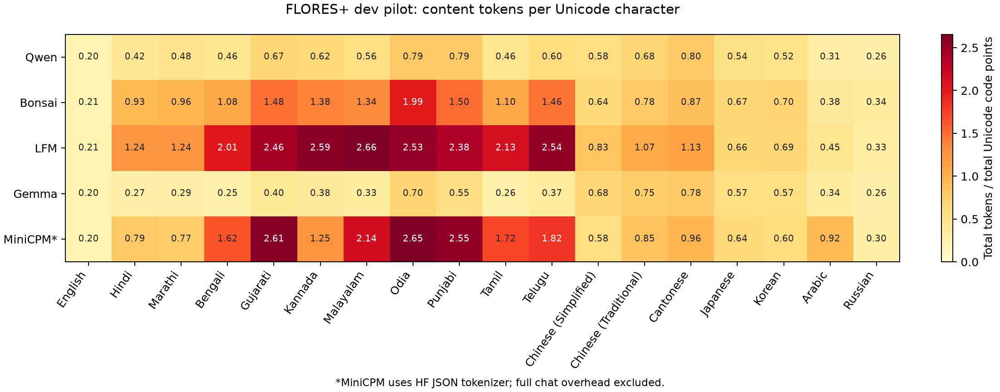

# Multilingual measurement pilot

Five frozen tokenizers and the unchanged LocalMind estimator, measured on 100 aligned dev sentence IDs across 18 language varieties. No fitting or calibration; devtest was not downloaded.

Numeric measurement rows: **9000**. Raw texts and token IDs are excluded from the result table.

Each cell is the sum of content tokens divided by the sum of Unicode code points. It is not a word count or a measure of model quality. Comparisons within a language use identical text.

| Tokenizer | Median absolute prediction error | Worst under | Worst over | Within ±20% |
| --- | ---: | ---: | ---: | ---: |
| Qwen | 8.70% | -48.28% | +50.00% | 1482/1800 |
| Bonsai | 4.35% | -47.06% | +56.25% | 1528/1800 |
| LFM | 3.28% | -52.27% | +137.50% | 1468/1800 |
| Gemma | 11.11% | -48.72% | +50.00% | 1387/1800 |
| MiniCPM* | 3.49% | -57.69% | +62.50% | 1536/1800 |

## Indian, CJK and other groups

| Tokenizer | Group | Rows | Median absolute error | Within ±20% |
| --- | --- | ---: | ---: | ---: |
| Qwen | Other | 300 | 10.13% | 259/300 |
| Qwen | Indian | 1000 | 6.32% | 968/1000 |
| Qwen | CJK | 500 | 20.00% | 255/500 |
| Bonsai | Other | 300 | 9.09% | 260/300 |
| Bonsai | Indian | 1000 | 2.43% | 1000/1000 |
| Bonsai | CJK | 500 | 18.75% | 268/500 |
| LFM | Other | 300 | 7.60% | 265/300 |
| LFM | Indian | 1000 | 0.75% | 1000/1000 |
| LFM | CJK | 500 | 25.00% | 203/500 |
| Gemma | Other | 300 | 8.76% | 268/300 |
| Gemma | Indian | 1000 | 8.76% | 881/1000 |
| Gemma | CJK | 500 | 21.21% | 238/500 |
| MiniCPM* | Other | 300 | 7.55% | 260/300 |
| MiniCPM* | Indian | 1000 | 1.41% | 999/1000 |
| MiniCPM* | CJK | 500 | 18.18% | 277/500 |

## Largest tokenizer gaps within a language

Ratio of the largest total token count to the smallest total count on that language’s same selected sentences. This compares tokenizers, not translations of different lengths.

| Language | Most tokens | Fewest tokens | Ratio |
| --- | --- | --- | ---: |
| Tamil | LFM | Gemma | 8.23× |
| Bengali | LFM | Gemma | 8.03× |
| Malayalam | LFM | Gemma | 7.98× |
| Telugu | LFM | Gemma | 6.89× |
| Kannada | LFM | Gemma | 6.84× |
| Gujarati | MiniCPM* | Gemma | 6.58× |
| Punjabi | MiniCPM* | Gemma | 4.63× |
| Hindi | LFM | Gemma | 4.59× |
| Marathi | LFM | Gemma | 4.33× |
| Odia | MiniCPM* | Gemma | 3.78× |

## Limits

The original LocalMind fitting corpus is not fully available, so absence of overlap with all its training examples cannot be proven. We check overlap with its 38 published fixtures. Model-training exposure to FLORES is not assessed. The dataset is evaluation-only; any new estimator must be fitted on separate text.

No model inference, new fitting, full chat templates, context-overflow simulation or browser benchmark was run. The pre-token count is a diagnostic of the tokenizer’s pre-tokenizer applied after its normalizer; added-token extraction is not emulated at that stage. Content-token counts use the full tokenizer with added special tokens disabled.

The pilot is smaller than the planned full study (20+ tokenizers and broader language coverage). See run.json, validation.json, summary.json and the local ground-truth.parquet. Downloaded text remains in the ignored cache; FLORES+ attribution and use conditions are in docs/PHASE1_PILOT.md.
