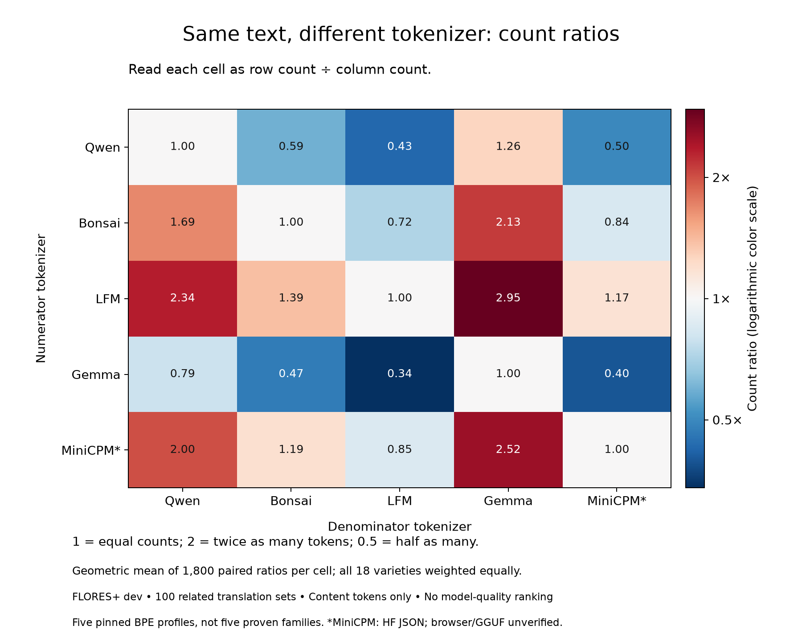
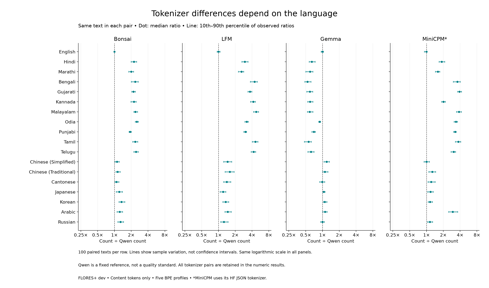
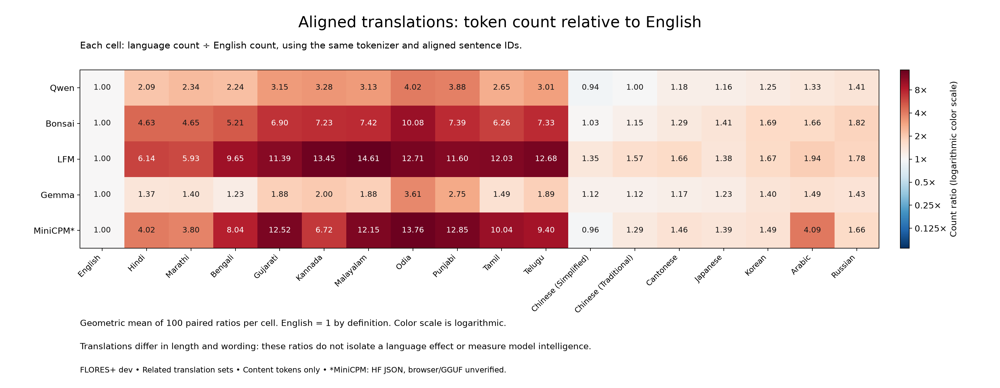

# Direct tokenizer-count comparison

Exploratory analysis of the already-measured FLORES+ dev pilot, 2026-10-18.
No new tokenization, fitting, devtest access or model inference.

## Same-text comparison

Each cell is the geometric mean of per-text row/column count ratios over 1,800 matched texts.
A value of 2 means twice as many tokens on this multiplicative average, not twice the cost
or half the useful context in an actual application. No universal winner is implied.

| Numerator / denominator | Qwen | Bonsai | LFM | Gemma | MiniCPM* |
| --- | ---: | ---: | ---: | ---: | ---: |
| Qwen | 1.000 | 0.592 | 0.427 | 1.260 | 0.499 |
| Bonsai | 1.689 | 1.000 | 0.720 | 2.127 | 0.842 |
| LFM | 2.344 | 1.388 | 1.000 | 2.953 | 1.170 |
| Gemma | 0.794 | 0.470 | 0.339 | 1.000 | 0.396 |
| MiniCPM* | 2.004 | 1.187 | 0.855 | 2.525 | 1.000 |

## Differences within each language

Dots are median per-text ratios; horizontal lines cover the 10th–90th percentile.
Intervals describe the sample spread, not confidence intervals. Reference choice is fixed
in the plan. Every other ordered pair and its language cells remains in comparisons.json.

For a concrete cross-language contrast, LFM/Gemma geometric mean ratios are:
- English: 1.022×; median 1.000, p10–p90 0.952–1.088 (100 texts).
- Tamil: 8.261×; median 8.352, p10–p90 6.663–10.330 (100 texts).
- Korean: 1.220×; median 1.222, p10–p90 1.105–1.333 (100 texts).

These examples illustrate variation; they do not establish its cause. They are geometric
means of ratios, so they need not equal earlier ratios of summed token counts.

## Aligned translations

English is a reference only. Translation length, wording and writing systems vary together.
These results are not a controlled test isolating language or a measure of language quality.

## Evidence and limits

- [comparisons.json](comparisons.json): 475 tokenizer-pair summaries and 90 translation summaries, including self-comparisons.
- [count-data.json](count-data.json): numeric count cube and alignment IDs; no source text or token-ID sequences.
- [validation.json](validation.json): pairing checks, hashes and versions.
- [Inventory](../inventory-01/REPORT.md): all five assets use BPE but have distinct pipeline fingerprints.
- [Specification](../../../config/comparative-pilot-v1.json) and [protocol](../../../docs/COMPARATIVE_STUDY_V2.md).

The 9,000 counts cover 1,800 texts and 100 related translation sets, not independent draws.
Five selected profiles do not represent all BPE tokenizers or other algorithm classes.
Content-only counts omit full chat templates and response reserves. Browser speed/memory
and model answer quality were not measured. MiniCPM is HF JSON, not verified GGUF parity.
All three figures have PNG/SVG/PDF exports. See the independent verification output after validation.
