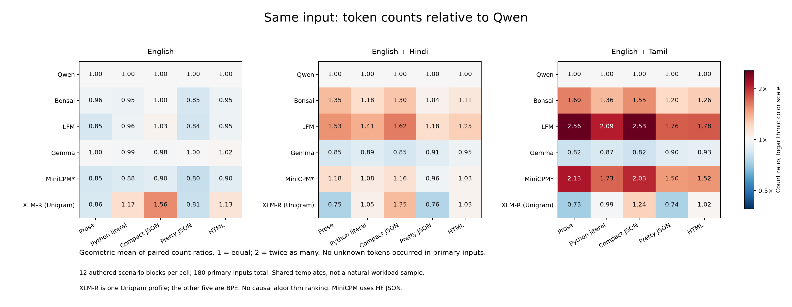
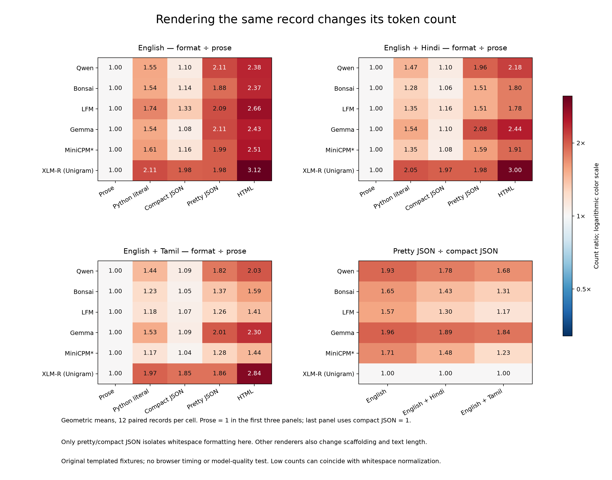
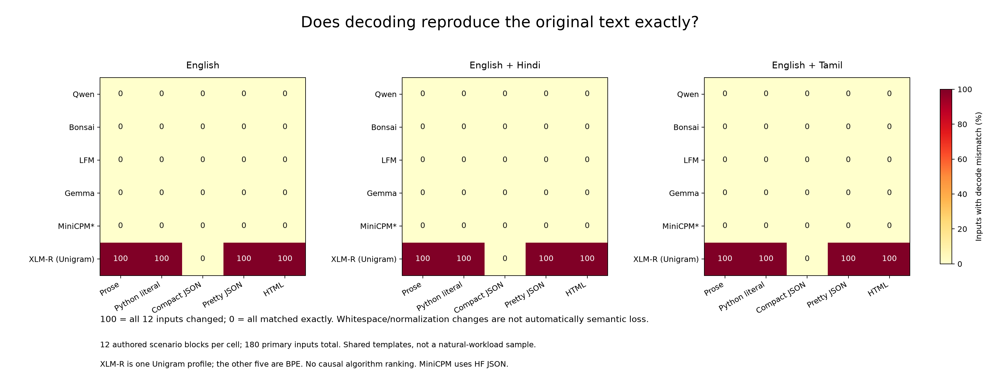

# Text types and a Unigram tokenizer: results

Controlled synthetic pilot, 2026-10-18. These results use original project fixtures, not FLORES+.

## What we measured

Twelve records × three content conditions × five renderers = 180 primary inputs.
Six tokenizer profiles give 1,080 primary measurements. Eight separate probes add 48 diagnostic measurements.
The same source record is rendered in each format; English structural labels remain in the mixed-language versions.
All examples are authored templates, not sampled natural documents or independently validated translations.

## Same text, different tokenizer



Each cell is the geometric mean of 12 same-input count ratios. Qwen is a fixed reference, not a quality standard.
All 540 ordered-pair/cell summaries, including self-comparisons, are retained in summary.json.
There were no unknown-token inputs in the primary workload. The unknown-free summaries therefore match it.

## Formatting changes counts



Pretty JSON and compact JSON encode identical records; their only text difference is serialization whitespace.
Other comparisons also change scaffolding and length, so they do not isolate a general format effect.

| Profile | English pretty/compact | English + Hindi | English + Tamil |
| --- | ---: | ---: | ---: |
| Qwen | 1.928× | 1.783× | 1.677× |
| Bonsai | 1.645× | 1.428× | 1.306× |
| LFM | 1.569× | 1.295× | 1.172× |
| Gemma | 1.962× | 1.894× | 1.838× |
| MiniCPM* | 1.714× | 1.480× | 1.234× |
| XLM-R (Unigram) | 1.003× | 1.002× | 1.002× |

Ratios are geometric means of 12 per-record ratios, not ratios of total tokens.

## Exact reconstruction and unknown symbols



XLM-R changes decoded whitespace in all primary prose, Python-literal, pretty-JSON and HTML inputs.
Compact JSON reconstructs exactly in this fixture set. This is exact-string behavior, not a verdict on meaning.
Its separate emoji/rare-character probes contain unknown IDs; those probes never enter the primary summaries.
The BPE profiles also have normalization differences on some accent probes. Inspect all probe rows rather than assuming universal losslessness.

Example from the original indentation probe:

```python
def ready():
    return True
```

XLM-R decodes it as `def ready(): return True`. This example shows changed layout; it does not by itself show changed program behavior.

## Scope and evidence

- [All summary cells](summary.json): 90 count/coverage cells, 540 tokenizer ratios, 90 format/prose ratios and 18 pretty/compact ratios.
- [Measurements](../run-01/measurements.json), [token examples](../run-01/token-examples.json) and [profile inventory](../run-01/inventory.json).
- [Original public fixtures](../../../data/fixtures/text-types-v1.json), [frozen plan](../../../config/text-types-v1.json) and [protocol](../../../docs/TEXT_TYPES_V1.md).
- Six profiles: five BPE and one Unigram. Vocabulary, training data, normalization and model purpose differ together.
- XLM-R comes from an encoder model; this is not a chat-model comparison or an isolated algorithm experiment.
- Token counts were measured without truncation or special tokens. Full chat prompts, speed, memory and answer quality were not measured.
- No fitting, model inference, FLORES access or paid service calls.

## Reproduction

Use the pinned Python environment and existing cached assets. Pin/acquire the additional profile with:

```sh
.venv/bin/python scripts/pin_unigram.py --revision e73636d4f797dec63c3081bb6ed5c7b0bb3f2089
.venv/bin/python scripts/build_text_type_fixtures.py
.venv/bin/python scripts/measure_text_types.py --output results/reproduction-text-types/run-01
node scripts/check_text_types_js.mjs results/reproduction-text-types/js-01
.venv/bin/python scripts/analyze_text_types.py --source results/reproduction-text-types/run-01 --output results/reproduction-text-types/analysis-02
```

The measurement command resumes verified per-profile shards; analysis needs a fresh directory.
Runtime-serialized Unigram JSON is retained locally as a documented compatibility check. JS successfully used the original legacy JSON.
Original-versus-serialized Python ID parity covers all 188 inputs; no source asset bytes were edited.

## Verification completed after analysis

[Independent checks](../verification.json) passed: all 1,128 Python/JS ID-sequence
hashes match, all row metadata were recomputed, and all 6,552 numeric summary
values across 738 groups agree with separate arithmetic. All 14 source asset
files match their pinned hashes. All three final PNGs were visually inspected.

Run the final check after the reproduction commands (the verifier expects the
run-01/js-01/analysis-02 layout; checking a retained failed plotting attempt
is optional and happens only if one is present):

```sh
.venv/bin/python scripts/verify_text_types.py --base results/2026-10-18-text-types
```

Use `--base results/reproduction-text-types` for the reproduction directory above.
The verifier refuses to overwrite an existing verification record. To rerun an
audit, use a copied run directory without its verification.json. The earlier
analysis-01 failed while plotting because of a Matplotlib keyword-argument
requirement. Its script, failure record and numerically identical summary remain
preserved; analysis-02 supplies the finished figures and report.
