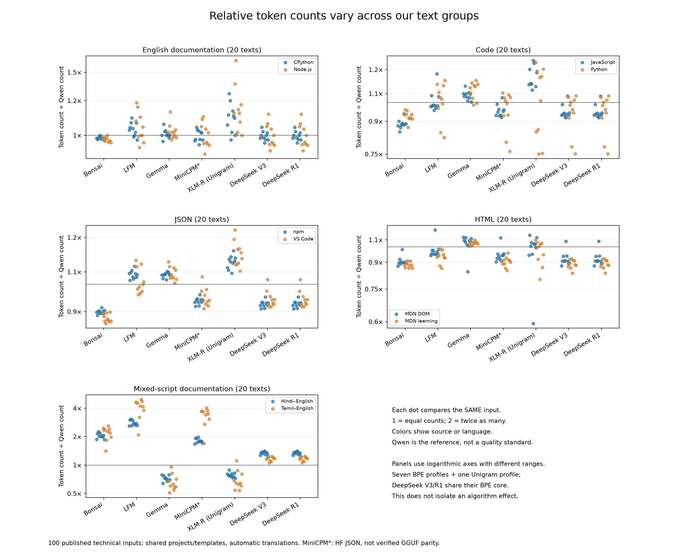
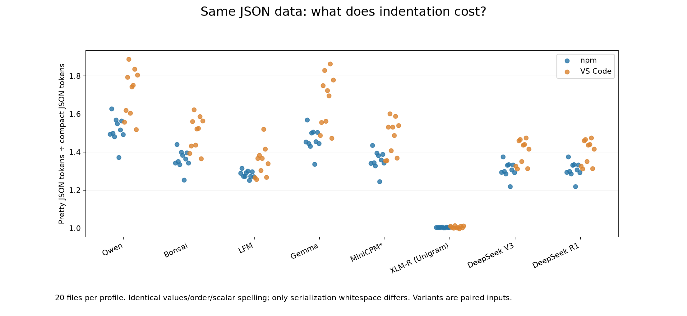
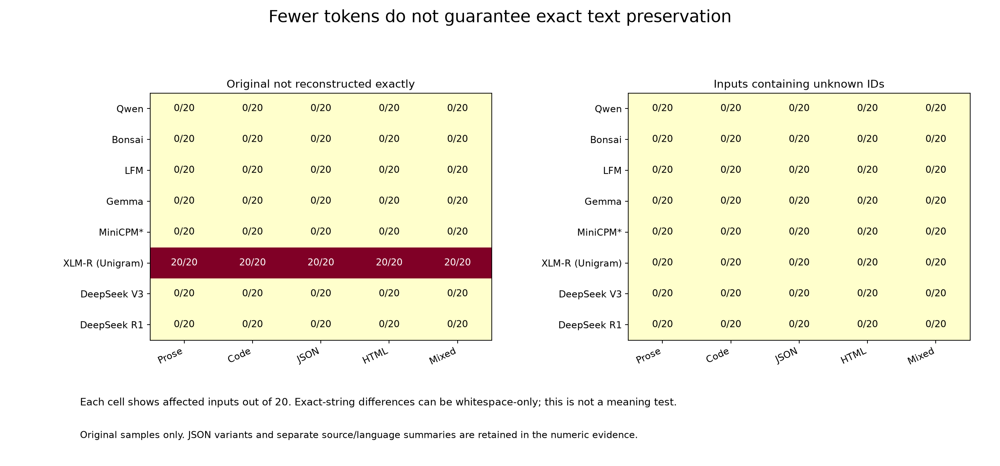

# DeepSeek tokenizer extension

Completed 2026-10-19. Added official **DeepSeek V3 and R1** configurations to the
six-profile comparison: **280 new corpus measurements**, plus eight separate
marker probes. The combined corpus evidence contains **1,120 rows**; the previous
840 rows are reused unchanged. Inputs remain 100 originals and 40 JSON variants.

## Findings

V3 and R1 produce identical token sequences on all **140/140 corpus inputs**.
Both recover every input exactly and produce no unknown-token IDs in this sample.
The table therefore applies to both profiles; matching rows are not independent
support for a second tokenizer family.

| Text group | DeepSeek ÷ Qwen | Interpretation |
| --- | ---: | --- |
| English documentation | 0.997 | 0.3% fewer tokens |
| Code | 0.943 | 5.7% fewer tokens |
| JSON originals | 0.936 | 6.4% fewer tokens |
| HTML | 0.905 | 9.5% fewer tokens |
| Mixed-script documentation | 1.244 | 24.4% more tokens |

Each factor is the geometric mean of 20 same-input ratios; 1 means equal counts.
The mixed group contains ten Hindi–English and ten Tamil–English samples from
different lessons. These results describe the sampled technical text, not general
model quality or a language-only effect.



Each dot is one original input; colors separate sources/languages. Panel ranges
differ. V3/R1 are shown separately to preserve configuration identity.

Indented JSON uses **35.2% more tokens** than compact JSON for both DeepSeek
profiles (factor 1.3516; npm 1.306, VS Code
1.399). The paired variants preserve values and differ only in serialization whitespace.





## Shared core, different configurations

The pinned assets share their BPE vocabulary/merges, normalization, pre-tokenizer,
decoder and post-processor: 128,000 base vocabulary entries and 128,815 entries
including added tokens. Two added-token definitions and the chat templates differ.
This is shared component identity, not proof of interchangeable full prompts.

| Separate diagnostic input | V3 tokens | R1 tokens |
| --- | ---: | ---: |
| Plain-text control | 4 | 4 |
| `<think>` | 3 | 1 |
| `</think>` | 3 | 1 |
| Markers embedded in a sentence | 10 | 7 |

These four synthetic probes target known asset differences and are excluded from
corpus statistics. Python/JS agree on all eight probe encodings. All probe strings
also reconstruct exactly in Python. [Probe inputs](../../data/fixtures/deepseek-probes-v1.json).

For browser budgeting, model size alone does not identify a tokenizer. Shared
core rules may yield matching content counts, while special tokens and chat
formatting still require configuration-specific handling. No browser startup,
memory, download-time, latency or full-prompt measurements were made here.

## Verification and reproduction

The [pre-encoding protocol](../../docs/DEEPSEEK_EXTENSION_V1.md) and
[configuration](../../config/deepseek-extension-v1.json) were published in commit
`2a5ea03e18333b220196bed373e69c4370103b82` before measurement. [Independent checks](verification.json)
verify 1,120 Python/JS sequence-hash matches, 1,120 recomputed metadata rows,
23 asset files, 1,944 summary groups, 18,008 numeric values and 6,560 ratios.
Existing JS results were reused with pinned hashes; all 280 new encodings were
run in both runtimes. Independent arithmetic uses a separate implementation.

- [Measurements](run-01/measurements.json), [summaries](analysis-01/summary.json),
  [individual ratios](analysis-01/per-input-ratios.json), [JSON ratios](analysis-01/per-json-ratios.json).
- [Asset identity](identity.json), [observed identity/probe checks](identity-checks.json),
  [figure review](figure-review.json). Each graph has PNG, SVG and PDF exports.
- Official pinned sources: [V3](https://huggingface.co/deepseek-ai/DeepSeek-V3/tree/e815299b0bcbac849fa540c768ef21845365c9eb)
  and [R1](https://huggingface.co/deepseek-ai/DeepSeek-R1/tree/56d4cbbb4d29f4355bab4b9a39ccb717a14ad5ad).
  [V3 lock](../../config/deepseek-v3-tokenizer.lock.json) and [R1 lock](../../config/deepseek-r1-tokenizer.lock.json).

With pinned local source data, tokenizer caches and prior verified results:

```sh
.venv/bin/python scripts/measure_deepseek.py --output results/reproduce-deepseek/run-01
node scripts/check_deepseek_js.mjs results/reproduce-deepseek/js-01
.venv/bin/python scripts/analyze_deepseek.py --base results/reproduce-deepseek --output results/reproduce-deepseek/analysis-01
.venv/bin/python scripts/check_deepseek_identity.py --base results/reproduce-deepseek
.venv/bin/python scripts/verify_deepseek.py --base results/reproduce-deepseek
```

Use a fresh output root. Measurement resumes only with matching signatures.
Runtime versions and source hashes are saved with the run; the plan retains
hashes of all scripts and reused inputs. No weights or repository code were loaded.
Raw source text and tokenizer assets remain excluded from publication.

## Limits

This is exploratory extension on an already inspected corpus. Technical-source
bias, shared templates, unequal lengths and automatic translations remain.
Eight configurations do not represent eight independent families. The DeepSeek
releases are specifically V3 and R1, not all releases or live API behavior. Counts
exclude chat formatting; enabling the raw tokenizer's special-token setting
added zero tokens here, which does not establish zero full-prompt overhead.
Decoding was checked in Python, not independently in JS. The MiniCPM HF/GGUF
caveat and the earlier [study limitations](../2026-10-19-published-experiment/REPORT.md)
still apply. No fitting, model-answer evaluation or FLORES+ access occurred.
