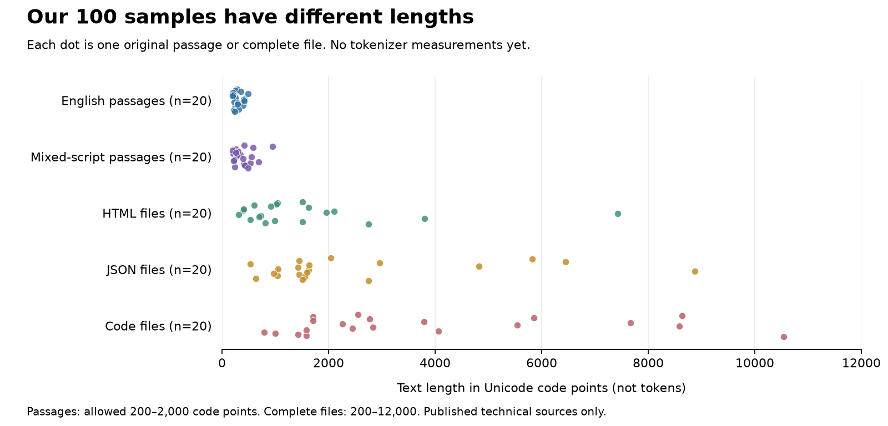

# Published technical corpus — collection checkpoint

Completed **2026-10-19**, before tokenizer measurement.

## What we achieved

We collected and checked **100 samples: 20 in each of five text groups**.
Every source/language quota reached ten; no replacement source or quota change
was needed. A sample is either one original paragraph or one complete source file.
The final selection encountered 129 file paths, including four skipped because
their translated lesson had already been selected. There are 775 recorded file/
paragraph decision events; these are not 775 different documents.

| Text group | Source split | Samples | Shortest / middle / longest (code points) |
| --- | --- | ---: | --- |
| English documentation | 10 CPython + 10 Node.js | 20 | 200 / 269 / 489 |
| Code files | 10 Python + 10 JavaScript | 20 | 793 / 2663 / 10,543 |
| JSON package files | 10 npm + 10 VS Code | 20 | 534 / 1570 / 8,874 |
| HTML examples | 10 MDN DOM + 10 MDN learning | 20 | 309 / 1006.5 / 7,425 |
| Mixed-script documentation | 10 Hindi–English + 10 Tamil–English | 20 | 203 / 370.5 / 953 |

The middle number is the **median**: the midpoint of the sorted lengths.
A Unicode code point is our precise length unit; it is not a token and does not
always equal one visible symbol, especially when marks combine with letters.



Each dot is a sample. English and mixed-script passages are short, while complete
files vary much more. This is a property of this corpus, not evidence that one
tokenizer is better. The same file must go to each tokenizer for fair paired
comparisons. Category-wide raw token totals would mix length with text type.

## What the checks caught

- Generated encoding files and a Python unit-test file were excluded.
- Review removed image-caption blocks, translation disclaimers and passages whose
  English letters occurred only in web addresses. Proper names alone were not
  counted as English words or technical identifiers.
- Rejections advanced to the next candidate in the existing hash order. Earlier
  provisional manifests and review labels are preserved, including their mistakes.
- The two language groups contain **20 different lesson families**, not two
  translations of the same ten lessons.
- The selected npm workspace files declare **ISC** in their package fields and
  nearer license files; using only the repository root Artistic-2.0 label would
  have missed this. These specific notices are linked and hashed in the manifest.

## What passed

- All 100 selected files match the pinned Git blob identities and full-file SHA-256 hashes.
- Every excerpt is an unchanged maximal nonblank paragraph with verified byte
  offsets; every code/JSON/HTML input is the entire original file.
- All length and script thresholds passed; all 20 JSON inputs parse strictly,
  including duplicate-key rejection and exact numeric parsing.
- All 100 selected files and samples have recorded Codex acceptance reviews.
- All 21 distinct referenced notice files passed their saved hashes.
- All **4,950 pairs** passed the predefined duplicate rule. The largest character
  5-gram similarity was **0.815**, below the fixed **0.90** rejection cutoff.
- An offline replay reproduced both the final manifest and decision log byte-for-byte.
- Eight focused tests cover Unicode/CRLF boundaries, code fences, RST blocks,
  frontmatter, strict JSON/number precision, duplicate normalization and URL screening.
- Plot data match all 100 manifest lengths; the PNG was visually inspected.

These are independently recomputed integrity checks from a separate script,
not a second researcher or human review. Meaning/language and terms applicability
still rely on the saved AI-assisted review.

## Limits to carry into the next experiment

These are technical convenience sources, not representative web traffic. Both
HTML repositories belong to MDN; some examples share templates. HTML includes
demonstration/placeholder text, including one Lorem ipsum page, and source files
may mix code, comments and license notices. Known related exercises are tagged
in sample reviews. The duplicate cutoff does not make documents independent.

The Hindi/Tamil source uses automatic translations, and translation quality is
not certified. Some passages are awkward or incomplete upstream; we preserve
their exact text. Latin script can be a technical identifier rather than an English
sentence. Inline source markup remains in documentation passages.

npm manifests share template tooling and some fields can be tool-maintained;
the exclusion checks identify generated-file headers, not proof that every byte
was human-authored. The VS Code group includes a test-utility package manifest,
which is metadata rather than test-fixture code. Nothing was executed.

Original input text totals 183,414 UTF-8 bytes. The full source files containing
those inputs total 1,704,732 bytes. Raw files and source notices stay local under
ignored `data/raw/published-text-v1/`; GitHub contains identifiers, hashes, decisions,
scripts and evidence, not a re-hosted text corpus. Linked assets were not fetched.

## Evidence and reproduction

- [Final sample manifest](collection-final/manifest.json) — exact inputs and provenance, without text.
- [Final review labels](reviews-final.json) and [selection decisions](collection-final/decisions.jsonl).
- [Independent validation](validation.json), [offline replay/figure checks](replay-and-figure-checks.json), and [boundary tests](boundary-checks-final.txt).
- [Frozen corpus lock](../../config/published-text-corpus-v1.lock.json).
- [Sampling protocol](../../docs/PUBLISHED_TEXT_SAMPLING_V1.md) and [implementation refinements](../../docs/PUBLISHED_TEXT_COLLECTION_V1.md).
- [Plot inputs](figures-01/plot-data.json), [SVG](figures-01/sample-lengths.svg) and [PDF](figures-01/sample-lengths.pdf).

Run from the project root, choosing unused output paths. Standard-library Python
and curl suffice for collection; plotting uses the project Matplotlib environment.

```sh
python3 scripts/inspect_published_sources.py --fetch --output /tmp/published-source-inventory-audit.json
python3 scripts/test_published_collection.py -v
python3 scripts/collect_published_text.py --fetch --reviews results/2026-10-19-published-corpus/reviews-final.json --output /tmp/published-corpus-reproduction
python3 scripts/verify_published_corpus.py --manifest /tmp/published-corpus-reproduction/manifest.json --reviews results/2026-10-19-published-corpus/reviews-final.json --output /tmp/published-corpus-validation.json
```

A restart reuses only downloads that pass their Git blob hash; the selector replays
from the beginning into a new directory, preserving earlier logs. Public metadata
can reconstruct the pinned text while upstream remains available; the Git push
does not back up ignored local raw files.

## Next step

Prepare and verify the compact/pretty JSON serializer, then run the same six pinned
tokenizers on this frozen corpus and compare counts, reconstruction and unknown
tokens. **No tokenizer measurements, fitting, model inference, browser trial or
FLORES+ devtest access occurred in this collection round.**
