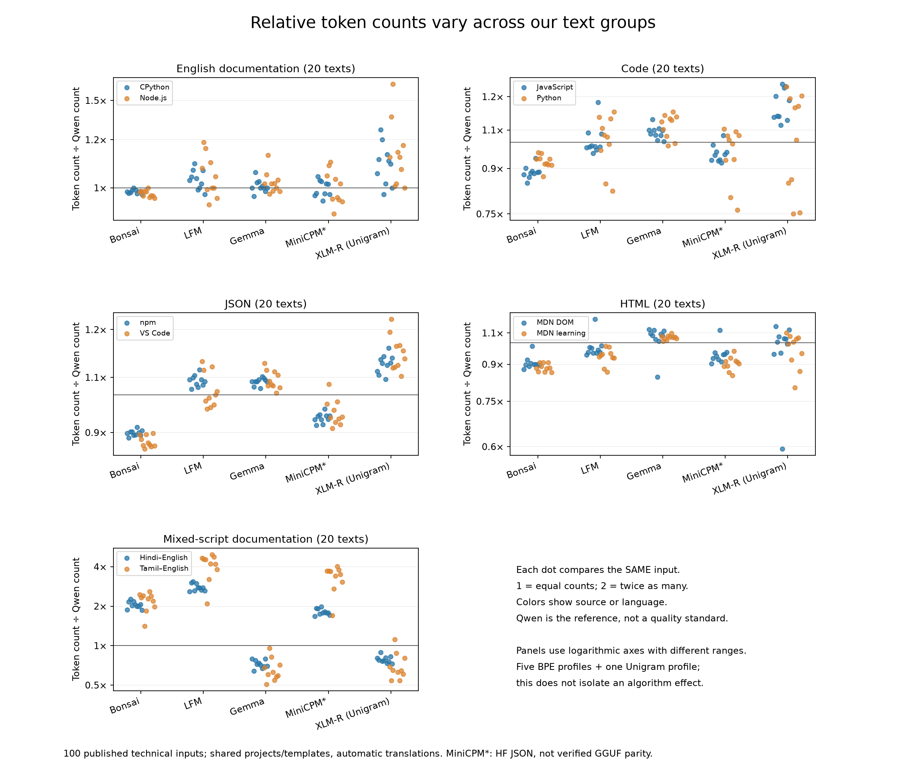
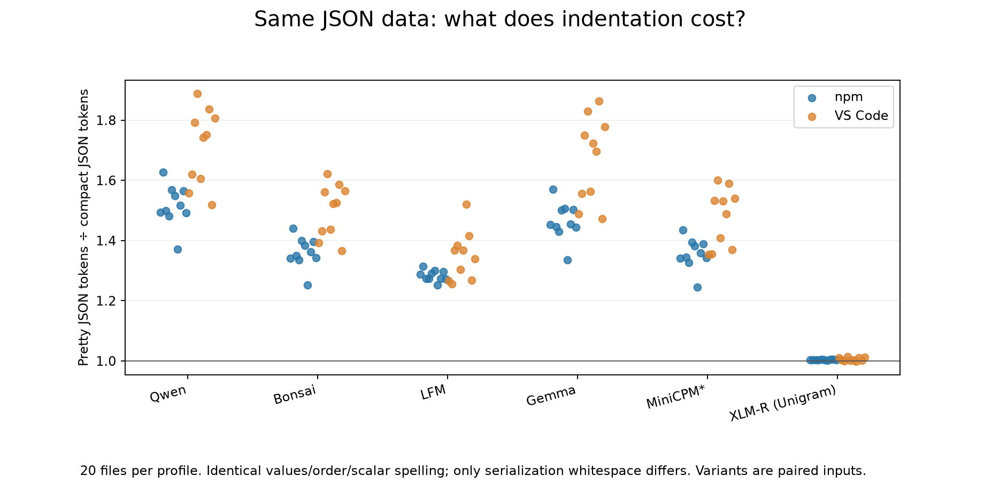
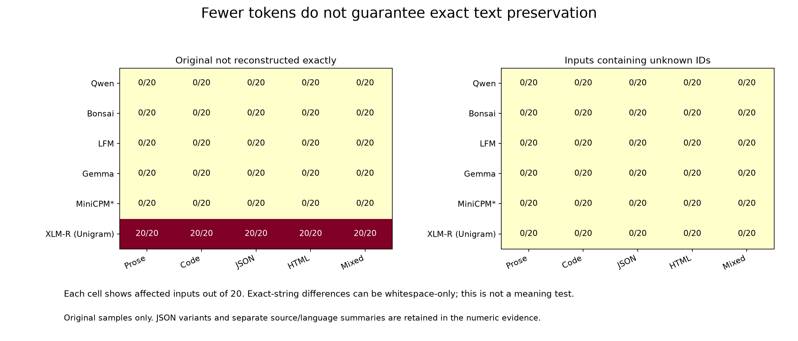

# Published technical-text experiment — 19 October 2026

We measured the same published text with six tokenizers. **Which tokenizer uses fewer tokens depends on the text. Formatting can also change the count, even when the JSON data stays the same.** A lower count does not by itself show better model answers or exact text preservation.

This is the next step after our authored examples: 100 frozen published samples, 20 each of English documentation, code, JSON, HTML and mixed-script documentation. We also made compact and indented versions of each of the 20 JSON files. That gives **140 inputs × six profiles = 840 measurements**, not 140 independent source samples.

The sampling plan, selected inputs and measurement protocol were fixed before encoding. Preparation was pushed in commit `b7c8b09deda75b475f973d8b98bccd06e07ad634` before the run.

## 1. Token counts depend on the text group

Each number below compares a tokenizer's count with Qwen's count on the **same input**, then summarizes the 20 ratios. **1.00 means equal; 2.00 means twice as many; 0.50 means half.** Qwen is simply our reference.

| Tokenizer profile | English documentation | Code | JSON originals | HTML | Mixed-script documentation |
| --- | ---: | ---: | ---: | ---: | ---: |
| Qwen | 1.000 | 1.000 | 1.000 | 1.000 | 1.000 |
| Bonsai | 0.978 | 0.905 | 0.888 | 0.896 | 2.098 |
| LFM | 1.046 | 1.004 | 1.026 | 0.955 | 3.330 |
| Gemma | 1.016 | 1.053 | 1.040 | 1.024 | 0.685 |
| MiniCPM* | 0.999 | 0.953 | 0.944 | 0.924 | 2.422 |
| XLM-R (Unigram) | 1.141 | 1.077 | 1.107 | 0.962 | 0.736 |

The summary is a **geometric mean**: an average suited to multiplication factors. For example, factors of 2 and 8 average to 4 this way. We do not divide pooled token totals or treat this as a model-quality score.

On mixed-script documentation, LFM uses about 3.33× Qwen's tokens and Gemma about 0.69×. On English documentation, their factors are much closer to 1. XLM-R uses about 14% more than Qwen on English documentation, but about 26% fewer on mixed-script documentation. There is no single count advantage that holds across all these groups.



Each dot is one input; colors identify the two source/language groups. Panels have different vertical ranges. The logarithmic axes represent multiplication factors, so compare the printed numbers rather than apparent distances between panels. The table summarizes dots; it does not replace their spread.

For mixed-script text, the separate ratios are:

| Profile | Hindi–English (10 inputs) | Tamil–English (10 inputs) |
| --- | ---: | ---: |
| Qwen | 1.000 | 1.000 |
| Bonsai | 2.042 | 2.156 |
| LFM | 2.780 | 3.988 |
| Gemma | 0.721 | 0.651 |
| MiniCPM* | 1.808 | 3.243 |
| XLM-R (Unigram) | 0.783 | 0.692 |

These are different lesson samples, not matched translations of the same passage. The difference cannot be attributed to language alone. Published Hindi/Tamil material comes from automatic translations and was not certified for translation quality.

## 2. Same JSON data, different layout

For this comparison we held values, key order, array order and scalar spelling constant between compact and pretty variants. Only spaces and line breaks outside strings differ. Neither variant has a trailing newline. Exact-number parsing preserves large integers, decimal precision and negative zero.

| Profile | Pretty ÷ compact, all 20 | Extra tokens, average factor | npm (10) | VS Code (10) | Observed smallest–largest factor |
| --- | ---: | ---: | ---: | ---: | ---: |
| Qwen | 1.6085 | 60.8% | 1.515 | 1.708 | 1.371–1.889 |
| Bonsai | 1.4275 | 42.8% | 1.360 | 1.499 | 1.253–1.622 |
| LFM | 1.3144 | 31.4% | 1.283 | 1.346 | 1.252–1.520 |
| Gemma | 1.5617 | 56.2% | 1.463 | 1.667 | 1.336–1.864 |
| MiniCPM* | 1.4132 | 41.3% | 1.355 | 1.474 | 1.245–1.601 |
| XLM-R (Unigram) | 1.0046 | 0.5% | 1.004 | 1.006 | 0.998–1.014 |

Qwen needs about **61% more tokens**, and Gemma about **56% more**, for our indented versions. XLM-R changes by about **0.46%**. These percentages describe geometric mean factors across these files; they are not universal formatting costs. Source-specific differences are visible, especially between npm and VS Code.



This extends the earlier authored-fixture experiment: formatting still affects counts, but the size differs. The earlier English fixtures gave roughly 1.93× for Qwen and 1.96× for Gemma. Those values were properties of those examples, not constants that apply to all JSON.

## 3. Can we recover the exact original text?

**Reconstruction** means turning text into token IDs, then decoding those IDs back to text. We check exact character equality separately from count.

- Each of the five BPE profiles reconstructs all **140/140 inputs exactly**.
- XLM-R reconstructs **0/100 originals**, **0/20 pretty JSON variants**, and **20/20 compact JSON variants** exactly.
- For 99 original XLM-R mismatches, removing whitespace from both strings makes them equal. The remaining HTML example also loses a leading U+FEFF byte-order mark, an encoding marker. Removing that marker and whitespace makes the strings equal.
- No input produced unknown-token IDs in any profile. Thus the planned unknown-free sensitivity summaries equal the full summaries for this sample.

XLM-R's small formatting overhead accompanies changes to whitespace. This is a reason to examine preservation alongside count, not proof that every mismatch changes meaning or program behavior. We did not execute source programs or evaluate semantic equivalence. Zero unknown IDs here does not guarantee coverage on all future text.



The graph covers the 100 originals only. JSON variants are reported above and retained in the numeric evidence. The [additional reconstruction diagnostic](reconstruction-diagnostics.json) records the whitespace/BOM checks without publishing text.

## Checks and limits

Python and JavaScript agree on all **840 token counts and complete ID-sequence hashes**. Separately, we recomputed all 840 rows' metadata and checked 14 tokenizer asset files, 140 original/canonical XLM-R encodings, all 20 JSON value/whitespace pairs, 1,146 summary groups, 10,698 numeric summary values and 3,720 individual ratios. The arithmetic checker uses a separate implementation; this is computational verification, not independent human review. Decoding metadata was recomputed in Python; JavaScript parity covers encoding, not independent decoding.

Counts exclude added special tokens. Counts with special tokens are saved separately; neither measure is a full chat prompt with system messages, tools and templates. Five profiles use BPE and one uses Unigram. One Unigram representative cannot establish a general algorithm effect. MiniCPM* uses its pinned Hugging Face JSON asset; equivalence with a GGUF/browser runtime is unverified.

This is a small, deliberately selected technical-source corpus, not a random sample of the web. It contains shared repositories/templates, different text lengths, and automatically translated documentation. Length-band and source-stratum summaries are saved, but some cells are small and some bands empty. Cross-category differences mix content, source, length and format; only the paired JSON test isolates the chosen layout change. Percentile ranges describe observed variation, not confidence intervals. No fitting, model-answer evaluation, FLORES+ access or browser speed/memory experiment occurred.

## Evidence and reproduction

- [Frozen experiment protocol](../../docs/PUBLISHED_TEXT_EXPERIMENT_V1.md), [configuration](../../config/published-text-experiment-v1.json), [collection report](../2026-10-19-published-corpus/REPORT.md), and [input metadata](preparation-01/input-manifest.json).
- [840 measurements](run-01/measurements.json), [all grouped summaries](analysis-02/summary.json), [same-input ratio dots](analysis-02/per-input-ratios.json), and [JSON ratio dots](analysis-02/per-json-ratios.json).
- [Independent verification](verification.json), [reproduced reconstruction diagnostic](reconstruction-diagnostic-verification.json), and [figure review and numeric identity](figure-review.json).
- [Measurement script](../../scripts/measure_published_text.py), [JS check](../../scripts/check_published_text_js.mjs), [analysis script](../../scripts/analyze_published_text.py), [independent verifier](../../scripts/verify_published_experiment.py), [diagnostic script](../../scripts/diagnose_published_reconstruction.py), and [report builder](../../scripts/report_published_text.py).

Each figure also has SVG and PDF files beside its PNG. Analysis-01 is retained; analysis-02 improves axis labels and a title. All three numeric JSON outputs are byte-identical across these versions. All three final PNGs were inspected for readable labels and clipping. The original analysis script is preserved in `source-snapshot/`.

With the locked source files, prepared private corpus and tokenizer caches regenerated locally, use a fresh results root:

```sh
.venv/bin/python scripts/measure_published_text.py --output results/reproduction-published/run-01
node scripts/check_published_text_js.mjs results/reproduction-published/js-01
.venv/bin/python scripts/analyze_published_text.py --base results/reproduction-published --output results/reproduction-published/analysis-01
.venv/bin/python scripts/verify_published_experiment.py --base results/reproduction-published
```

The verifier reads `analysis-01` by convention. Our final analysis-02 values have the same hashes as the verified analysis-01 values. Measurement can resume per profile with unchanged inputs; JS/analysis/verification need fresh destinations. See the preparation protocol and collection report for input reconstruction. Python tokenizers 0.23.2 and JS @huggingface/tokenizers 0.2.0 are pinned; run manifests retain versions and hashes.

Raw third-party text, decoded text and reconstructable token sequences remain local and ignored. GitHub preserves scripts, metadata, counts, hashes, graphs and logs, not those ignored files. No browser-deployment recommendation follows yet. A useful next design discussion is which broader sources and additional algorithm representatives to test before drawing general conclusions.
